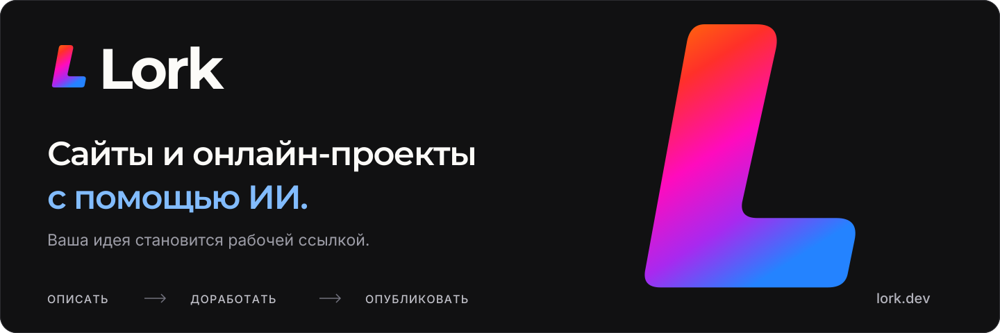

  

# Lork

ИИ-платформа для создания сайтов и запуска онлайн-проектов. Опишите идею, доработайте результат в диалоге и опубликуйте сайт по рабочей ссылке или на своём домене.

[Открыть Lork](https://lork.dev/) · [Профиль команды](https://github.com/Lork-dev) · [Авторы и контрибьюторы](https://github.com/Lork-dev#авторы-и-контрибьюторы) · [Документация](https://lork.dev/docs/introduction/welcome)

Публичный профиль организации находится в [profile/README.md](profile/README.md). Фирменная графика и кнопки — в [profile/assets](profile/assets).
