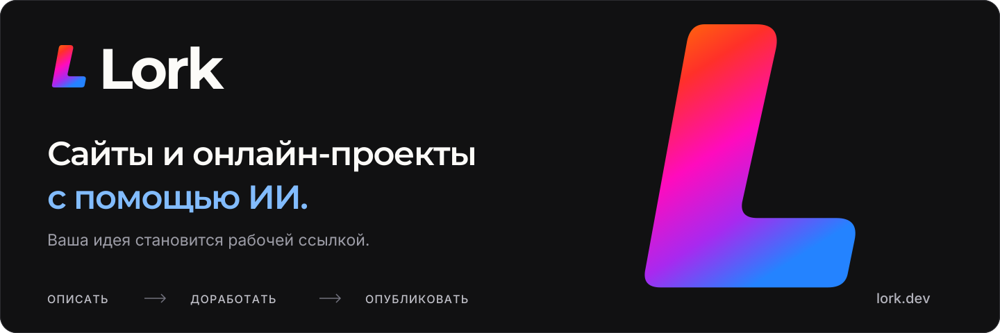
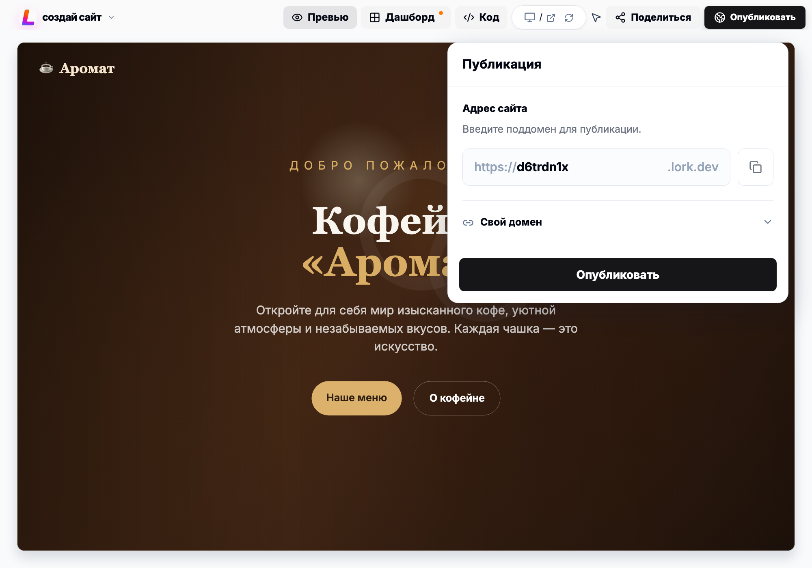

  

<h1 align="center">Опишите идею. Запустите сайт.</h1>

  Скажите, что хотите создать. Lork соберёт сайт с дизайном, текстами и формами. 
  Доработайте его в диалоге с ИИ — и поделитесь рабочей ссылкой.

  
  
  
  

---

## Что можно создать

**Lork — ИИ-платформа для сайтов и онлайн-проектов.** Начните с описания своего бизнеса, услуги или идеи. Первый результат можно менять сообщениями и визуальными правками, а затем опубликовать на поддомене Lork или подключить свой домен.

| Ваш проект | Что в нём может быть |
| --- | --- |
| **Лендинг и сайт для бизнеса** | Услуги, преимущества, цены, контакты и форма заявки. |
| **Магазин и каталог** | Витрина товаров, карточки и страницы категорий. |
| **Портфолио и сайт-визитка** | Работы, история специалиста и способы связаться. |
| **Сайт с записью или квизом** | Форма записи, вопросы и сбор обращений. |
| **Блог и база знаний** | Статьи, разделы и навигация по материалам. |

[Посмотреть шаблоны](https://lork.dev/templates) · [Выбрать тариф](https://lork.dev/pricing)

## От описания до публикации

1. **Опишите задачу.** Расскажите, для кого нужен сайт, что на нём показать и какой стиль выбрать. Можно добавить референс.
2. **Доработайте результат.** Попросите ИИ изменить блоки, тексты и оформление или внесите правки в интерфейсе. Проверяйте результат в превью.
3. **Опубликуйте проект.** Получите рабочую ссылку, подключите свой домен и продолжайте улучшать сайт после запуска.

  
   
  Отредактировали сайт — опубликовали из того же интерфейса.

## Авторы и контрибьюторы

Lork создают люди, которые работают над продуктом, его интерфейсом и инструментами.

<table>
  <tr>
    <td align="center" width="50%">
       
      <strong>Артём Маланин</strong> 
      <a href="https://github.com/artemmalanin979-create">GitHub</a> · <a href="https://www.linkedin.com/in/artem-malanin-3a9818420">LinkedIn</a> · <a href="https://x.com/ArtemMalaninDev">X</a>
    </td>
    <td align="center" width="50%">
       
      <strong>Олег Осколков</strong> 
      <a href="https://github.com/OskolkovOleg">GitHub</a> · <a href="https://t.me/Oleg_Oskolkov">Telegram</a>
    </td>
  </tr>
  <tr>
    <td align="center" width="50%">
       
      <strong>Данил Макаров</strong> 
      <a href="https://github.com/Jigokud0">GitHub</a> · <a href="https://www.linkedin.com/in/danil-makaroff-23719320b/">LinkedIn</a>
    </td>
    <td align="center" width="50%">
       
      <strong>Жэмбэ Михайлов</strong> 
      <a href="https://www.linkedin.com/in/zhembe/">LinkedIn</a> · <a href="https://t.me/zhembe">Telegram</a>
    </td>
  </tr>
</table>

## На связи

**По продукту и сотрудничеству:** [поддержка Lork в Telegram](https://t.me/Lorkdev). Обсудить свой проект и обменяться опытом можно в [сообществе Lork](https://t.me/+9c5CpOuB04VlMmNi).

  <a href="https://lork.dev/"><strong>lork.dev</strong></a> &nbsp;·&nbsp;
  <a href="https://lork.dev/docs/introduction/welcome">Документация</a> &nbsp;·&nbsp;
  <a href="https://lork.dev/blog">Блог</a> &nbsp;·&nbsp;
  <a href="https://lork.dev/community">Сообщество</a>

